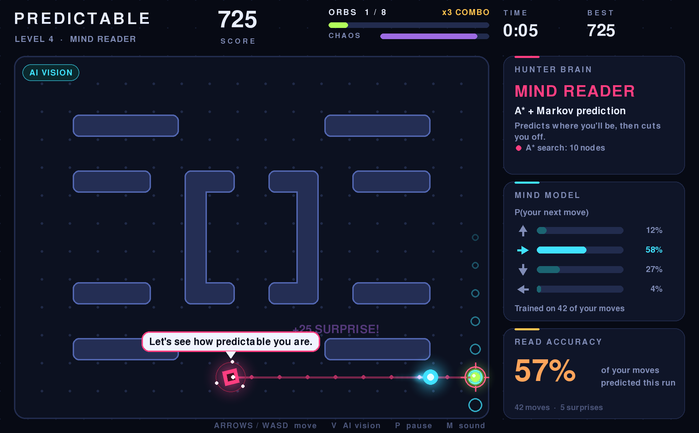

# PREDICTABLE — *It learns how you move.*

A neon arcade chase game written in **Python + pygame**, where the enemy is an AI
that **learns your movement habits while you play** and uses them to cut you off.

Collect orbs, survive the hunters, and try to stay unpredictable. At the end of
every run the game tells you how predictable you were:
*"The AI read 62% of your moves."*

Built for the *Artificial Intelligence Principles* mini project (2026).

**▶ Play it in your browser (desktop or phone): https://ayyappanasb.github.io/predictable/**



---

## How to play

| Control | Action |
|---|---|
| Arrow keys / WASD (or swipe) | Move |
| V | Toggle **AI Vision** (see what the hunters are thinking) |
| P / Esc | Pause |
| M | Sound on/off |

**On phones** the game picks a touch layout automatically:

* **Portrait:** the arena on top, AI cards below, and a big **D-pad** plus AI Vision / Sound /
  Pause buttons at the bottom.
* **Landscape:** the desktop layout with a bar of touch buttons.
* In both you can also **swipe anywhere**, and one stroke can chain several turns.
* Slow devices automatically switch to lighter effects.
* To try a layout on a computer, add `?layout=portrait` or `?layout=landscape` to the URL.

* Collect the green orbs to clear the level. Quick pickups build a **combo** (up to x5).
* Each level gives the hunter a **new AI technique**.
* **Surprise the AI**: when you make a move at a junction that the model confidently predicted
  wrong, you get **+25** and the **Chaos meter** fills. When it is full, the hunters get
  confused and wander randomly for 2.5s. Repeating one trick stops working, because the model
  learns it.
* The hunters **talk**: they taunt you when they predict your turn ("LEFT again? Classic.") and
  panic when you surprise them. Every line is triggered by the real model state.
* When you are caught, a **kill-cam** replays the path the AI predicted next to the path you
  took ("IT SAW THIS COMING 4 MOVES AGO").
* The results card gives you a **player type** (Creature of Habit, Zigzag Goblin, Chaos
  Gremlin... 8 to discover) and a personal line like
  *"You turned LEFT after UP 14 times. I noticed."*
* Tension: a heartbeat and a red glow around the arena as a hunter gets close, and generated
  music that speeds up from level 4.
* Power-ups: **Freeze** (stops hunters for 3s), **Decoy** (hunters chase a fake you for 4s), **Shield** (survive one hit).
* Escaping when a hunter is right next to you is a **Close call** (+50 and a slow-motion moment).

## The AI: one new technique per level

| Level | Hunter | AI technique | Idea |
|---|---|---|---|
| 1 | Wanderer | Random walk (+30% drift towards you) | Baseline: almost no intelligence |
| 2 | Chaser | Greedy hill-climbing | Steps to the neighbour closest to you; only looks 1 step ahead |
| 3 | Tracker | **A\* search** (Manhattan heuristic) | Optimal shortest path around walls |
| 4 | Mind Reader | **A\* + Markov chain prediction** | Predicts your next 8 moves, then intercepts |
| 5 | The Pack | **Multi-agent**: chaser + interceptor | One hunter chases, the other ambushes |
| 6 | The Mirror | **Generative use of your Markov model** + A\* partner | An AI copy that moves the way *you* move |
| 7+ | The Gauntlet | Mind Reader + Mirror, faster every level | Endless mode |

**Markov model (`game/ai/predictor.py`).** An order-2 n-gram model estimates
`P(next move | last two moves)` from counts, with Laplace smoothing and back-off
to shorter histories. It learns online from every move and keeps learning across
runs, so the hunter really does get to know the player.

**Interception (`game/ai/brains.py`).** The Mind Reader rolls the model forward to
predict the player's path, computes when the player and the hunter would each
reach every predicted cell (BFS distance × step time), heads for the first
cell it can reach in time, and plans the route with A\*.

**The Mirror (`Mirror` in `brains.py`).** It uses the player's model to *generate*
movement rather than to predict it. Each move m is scored
`log P_you(m | mirror's last moves) - 1.6 x (change in distance to you)`, so it moves the
way you would, but towards you (a Boltzmann-style policy mixing imitation with a goal).

**Fair collisions.** The AI plans on grid cells, but a catch only counts when the sprites
actually touch (distance < 0.6 cells), so what you see is what counts.

**Procedural arenas (`game/grid.py`).** Every level is generated: symmetric wall
pieces are placed and each layout is checked for connectivity (BFS) and dead ends
before it is accepted.

## Results (`python tools/experiment.py`)

**How predictable are different movement styles?** (accuracy over the last 500 of 1,500 moves, 5 seeds)

| Player | Prediction accuracy |
|---|---|
| Random mover | 31% (chance level with walls) |
| Looping pattern | 74% |
| Orb-seeker (A\* paths) | 79% |
| Straight-line mover | 97% |

**Which hunter is strongest?** An evasive bot vs each brain at the same speed, 30 trials, 60s limit:

| Hunter brain | Mean survival | Caught within 60s |
|---|---|---|
| Random walk (+drift) | 43.6s | 50% |
| Greedy | 35.3s | 63% |
| A\* | 32.4s | 73% |
| **A\* + Markov** | **27.2s** | **87%** |
| Mirror (your habits) | 39.3s | 53% |

The Mirror is deliberately *not* optimal: it plays the way you play, which is why level 6
pairs it with an A\* hunter.

Charts are written to `results/`.

## Project structure

```
main.py                 entry point (async loop: runs on desktop and in the browser)
game/
  config.py             all constants, colours and the level table
  grid.py               arena, BFS distances, procedural generation
  entities.py           player, hunters, orbs, power-ups
  world.py              game rules (headless: no drawing, fully testable)
  taunts.py             what the hunters say (triggered by the model's state)
  profile.py            player types for the results card
  render.py             all drawing: arena, HUD, AI panel, screens
  effects.py            particles, shake, flashes, floating text
  audio.py, storage.py  sound effects and save data (file / browser localStorage)
  app.py                window, input and screen state machine
  ai/
    astar.py            A* search and greedy step
    predictor.py        Markov n-gram move predictor
    brains.py           the hunter brains for each level
tests/                  231 tests (pytest): AI, rules, features, touch controls, all 3 layouts
tools/
  experiment.py         experiments + charts for the report
  screenshots.py        renders every screen headlessly
  make_sounds.py        synthesises all sound effects (no external assets)
  build_web.sh          builds the browser version with pygbag
```

## Running it

```bash
python -m venv .venv && source .venv/bin/activate
pip install -r requirements.txt
python main.py                 # play on desktop
python -m pytest               # run the tests
python tools/experiment.py     # reproduce the results
bash tools/build_web.sh        # build the web version (dist/predictable/build/web)
```

## Assets

Everything is original: graphics are drawn with code, and the sound effects are
synthesised by `tools/make_sounds.py`. Font: pygame's bundled default font.
